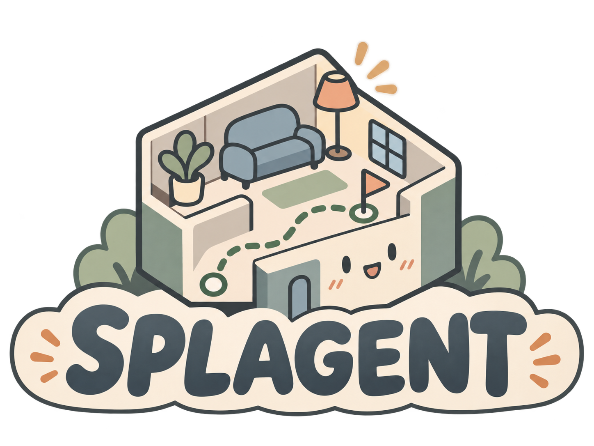
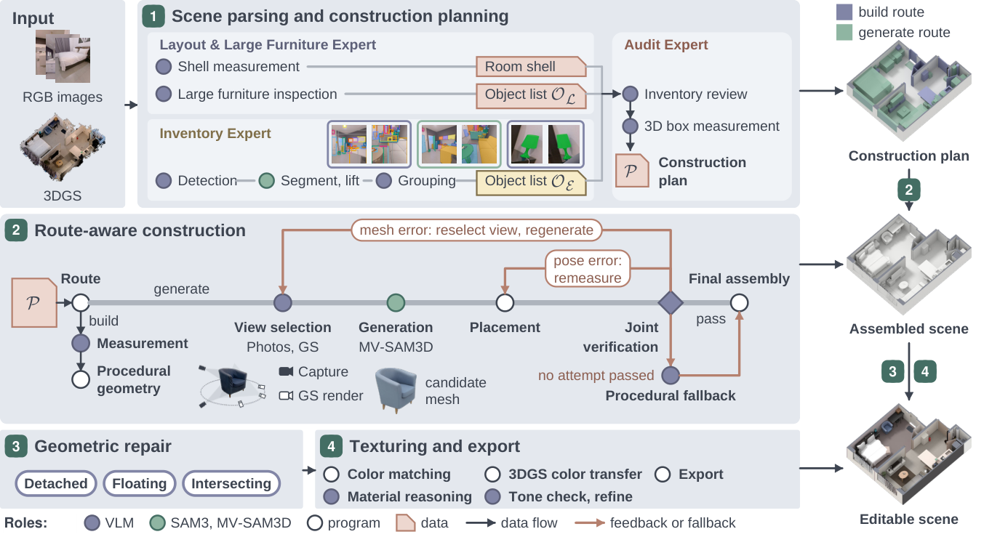

<div align="center">



# Splagent: 3DGS-Guided Agentic Discovery and Reconstruction of Compositional Indoor Scenes

**Official repository for the paper**

<p>
  <a href="https://xuqianren.github.io/Splagent/"></a>
  <a href="#"></a>
  <a href="#"></a>
  <a href="#"></a>
  <a href="#"></a>
</p>

</div>

## Demo

<div align="center">
<video src="assets/demo.mp4" poster="assets/demo_poster.png" controls muted loop playsinline width="95%"></video>
</div>

## News

- **2026/11** Project page online. Code and dataset will be released after cleanup.

## Introduction

Object-level indoor reconstruction recovers the objects of a real environment as separate, editable assets, supporting scene editing and embodied interaction. If a small object is omitted or merged with its support, the reconstructed scene loses an item that a user may want to move or a robot may need to grasp.

Building a scene-wide object inventory means reconciling partial observations across views: a small object that is obvious in a close-up may be overlooked in a wide view, similar-looking neighbours make instance identity ambiguous, and occlusion leaves metric size and position uncertain. Existing methods mostly focus on the shape and placement of objects that have already been proposed, with less attention to which instances are still missing.

**Splagent** is an agentic framework that reconstructs indoor scenes as collections of editable 3D assets. Its vision-language model (VLM) agents use a shared 3D Gaussian Splatting (3DGS) scene to build and audit an object inventory. The 3DGS scene supports both geometric queries and object-centric rendering in one common coordinate frame, and each inventory entry links an object to its supporting observations and a metric 3D bounding box.

## Method Overview

<div align="center">

</div>

1. **Scene analysis and image search.** Scene-level analysis covers room structure and large furniture, while an independent search over the source images aims for broad coverage, including a dedicated pass over full-resolution close-ups to detect small objects.
2. **Association and audit.** Prompted VLM agents use appearance and 3D position to associate detections across views. They reconcile the resulting instances with the scene-level inventory by merging duplicates, separating objects that were grouped together, and correcting labels.
3. **Measurement.** The Gaussian scene is used to measure a 3D bounding box for every retained object.
4. **Construction.** Objects with regular geometry are assembled from measured primitives; complex shapes use image-conditioned mesh generation.
5. **Verification and retry.** Agents check each generated asset against the source observations. On a mismatch they revisit the same Gaussian scene to adjust placement, remeasure the box, or render alternative views for regeneration.

## Highlights

- **One shared 3DGS scene** for associating observations across views, measuring objects in a common frame, and rendering object-centric views for generation and verification.
- **Better object coverage before construction**: a scene-level layout inventory is reconciled with an independent image search, including full-resolution close-ups for small objects.
- **Stronger object recovery**: on ScanNet++ and our captured indoor scenes, Splagent outperforms the evaluated multi-view baselines overall and on small objects. On ScanNet++ it reaches 84.09 recall / 75.95 F1 over all objects and 69.48 recall / 52.67 F1 over small objects, against at most 26.19 recall and 38.06 F1 for the baselines.
- **More accurate reconstruction**: the full pipeline produces more accurate foreground geometry on ScanNet++.
- **Transferable inventory**: replacing the native proposals of other reconstruction backends with our measured inventory improves foreground reconstruction for some of them.

## TODO List

- [x] Project page
- [ ] arXiv / paper PDF
- [ ] Pipeline code

## Quick Start

Code is not released yet.

## Citation

```bibtex
@article{ren2027splagent,
  title   = {Splagent: 3DGS-Guided Agentic Discovery and Reconstruction of Compositional Indoor Scenes},
  author  = {Ren, Xuqian and Li, Hao and Dai, Yalun and Hong, Fangzhou and Chen, Zhaoxi and Yap, Kim-Hui and Kannala, Juho and Wu, Minye and Liu, Ziwei},
  journal = {Technical Report},
  year    = {2027}
}
```
